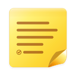

<div align="center">
  
  <h1>Stickie</h1>
  <p>A fast, local desktop sticky notes app for Linux, Windows, and macOS.</p>
</div>

## Features

- 📝 **Rich text editor:** Bold, italic, underline, strikethrough, text colors, highlighters, bullet lists, numbered lists, interactive checklists, and resizable tables.
- 🖼️ **Images:** Paste from clipboard, drag and drop, or pick from disk, stored locally via `stickie-asset://` with automatic orphan cleanup.
- 🎨 **Themes & colors:** Preset note colors (yellow, green, blue, pink) or custom hex colors with automatic WCAG text contrast, plus system/light/dark UI themes and font switching (`System`, `Sans`, `Serif`, `Mono`).
- 🔍 **Manager window:** Live search with match highlighting, sort by updated date, created date, or title, and import/export (`.txt`, `.md`, `.html`, `.json`).
- 💾 **Safe storage:** Atomic writes (`.tmp` with `fsync`, rename, and `.bak` fallback) and flush on exit.
- 🖥️ **Desktop integration:** Multi-monitor bounds safety, optional reopen-notes-on-launch, optional launch-at-login, and system tray controls.

## Install and Run

### 🐧 Linux (AppImage + Desktop Entry)

```bash
./scripts/install-linux.sh
```

This builds the AppImage and installs it to `~/.local/share/stickie/Stickie.AppImage`, `~/.local/bin/stickie`, and `~/.local/share/applications/stickie.desktop`. Use `--system` to install under `/opt/stickie`, or `--uninstall` to remove it.

To start Stickie:
- Open your desktop application menu, search for **Stickie**, and click it.
- Or run `~/.local/bin/stickie` in a terminal.

### 🪟 Windows

Build the installer with `pnpm run build:win`, run the generated NSIS `.exe` in `dist/`, then open **Stickie** from the Start Menu or Desktop shortcut.

### 🍎 macOS

Run from source with `pnpm install && pnpm run dev` (or package with `electron-builder` on macOS), then open **Stickie** from Applications or Spotlight.

## Development

Prerequisites: Node.js 20+ and `pnpm`.

```bash
pnpm install
pnpm run dev
pnpm run typecheck
pnpm run test
```

Packaging and maintenance:

```bash
pnpm run build:appimage
pnpm run build:linux
pnpm run build:win
pnpm audit
```

## Linux Notes

- **Wayland positioning:** By default on Linux, Stickie relaunches with `--ozone-platform=x11` and hardware acceleration disabled so XWayland preserves per-window `(x, y)` coordinates across restarts. Set `STICKIE_OZONE=wayland` to run natively on Wayland.
- **System tray:** Works out of the box on KDE Plasma and XFCE. On GNOME, install the AppIndicator and KStatusNotifierItem Support extension.
